

  

  <h1>Mania Tracker</h1>

  
An osu!mania community site built around a live score feed, for any country or globally.

  
<a href="https://mania-tracker.com"><strong>mania-tracker.com</strong></a>

  

    
    
    
    
    
    
    
  

  

    <a href="#features">Features</a>&nbsp;&nbsp;|&nbsp;&nbsp;<a href="#replay-viewer">Replay viewer</a>&nbsp;&nbsp;|&nbsp;&nbsp;<a href="#how-it-works">How it works</a>&nbsp;&nbsp;|&nbsp;&nbsp;<a href="#rating-algorithms">Algorithms</a>&nbsp;&nbsp;|&nbsp;&nbsp;<a href="#license">License</a>
  

 

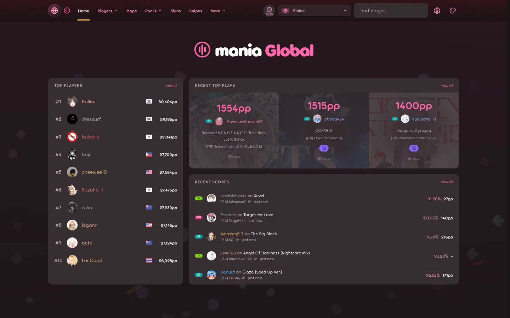

The country list is not fixed in code. Visiting an untracked country queues it for ingest, and a global scope aggregates every tracked country. The site is available in English, Spanish and Simplified Chinese.

## Features

<table>
  <tr>
    <td width="50%" valign="top">
      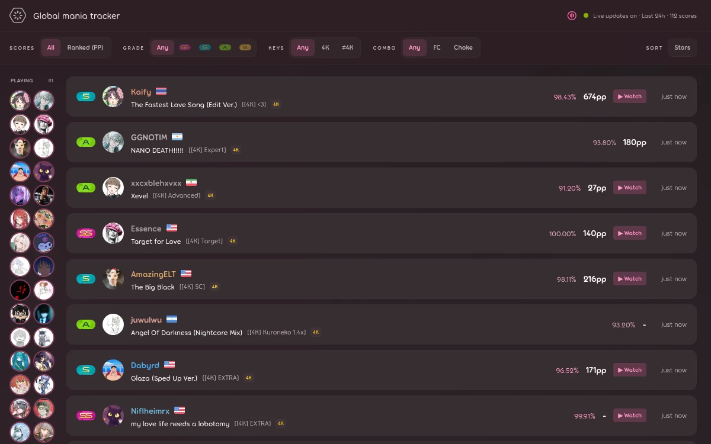
      <h3>Live tracker</h3>
      Scores as they are submitted, streamed over SSE, with grade, keymode and combo filters and a watch button on every play with a replay.
    </td>
    <td width="50%" valign="top">
      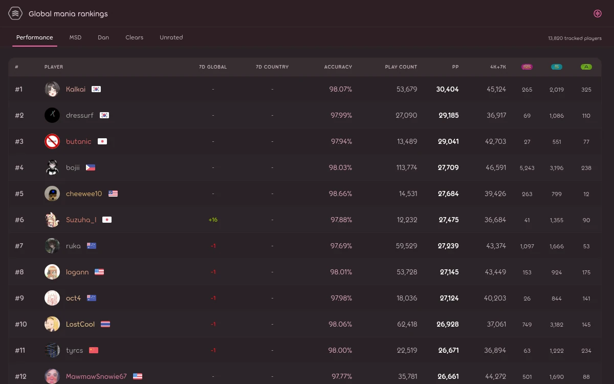
      <h3>Rankings</h3>
      Country and global boards by pp, MSD, dan and clears, with 7-day rank movement and per-keymode pp.
    </td>
  </tr>
  <tr>
    <td width="50%" valign="top">
      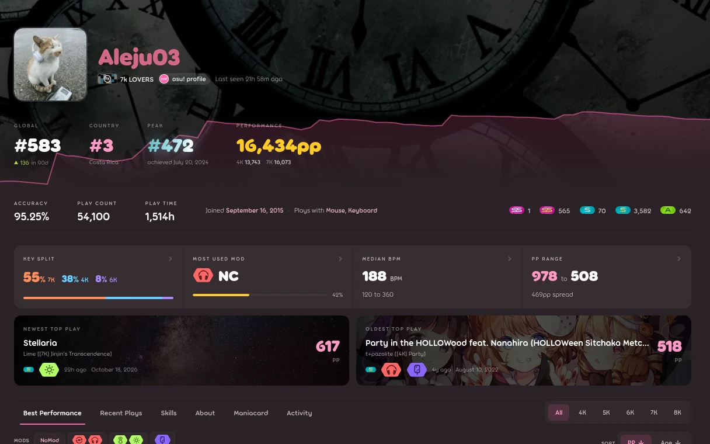
      <h3>Profiles</h3>
      Rank history, key split, mods, BPM and pp range, best and recent plays, BBCode about pages and an activity tab.
    </td>
    <td width="50%" valign="top">
      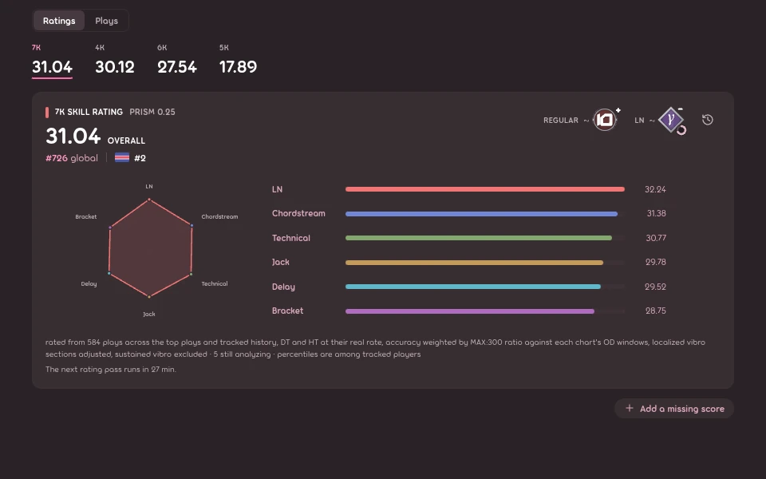
      <h3>Skill ratings and dan</h3>
      Per-keymode ratings by skillset, from MinaCalc on 4K and Prism on 6K to 8K, plus regular and LN dan estimates.
    </td>
  </tr>
  <tr>
    <td width="50%" valign="top">
      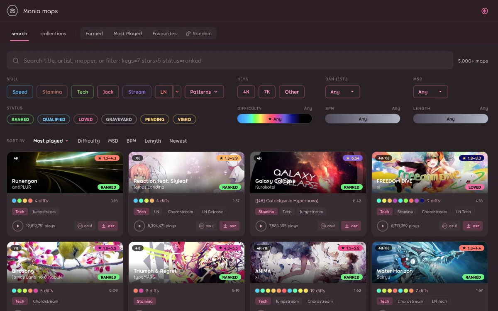
      <h3>Maps</h3>
      Search by skill, pattern, keymode, dan, MSD, BPM and length, with audio previews, collections and <code>.osz</code> downloads.
    </td>
    <td width="50%" valign="top">
      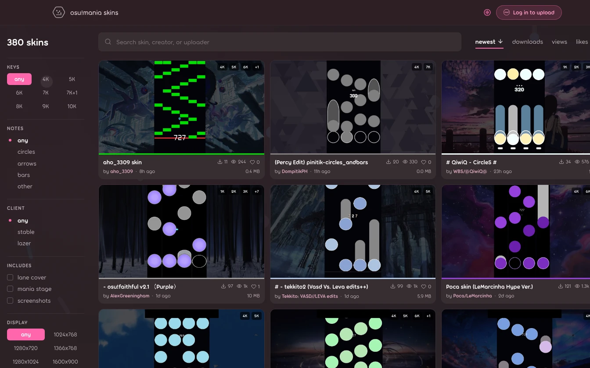
      <h3>Skins</h3>
      A community skin gallery filtered by keymode, note style, client and resolution, with a preview of each skin.
    </td>
  </tr>
  <tr>
    <td width="50%" valign="top">
      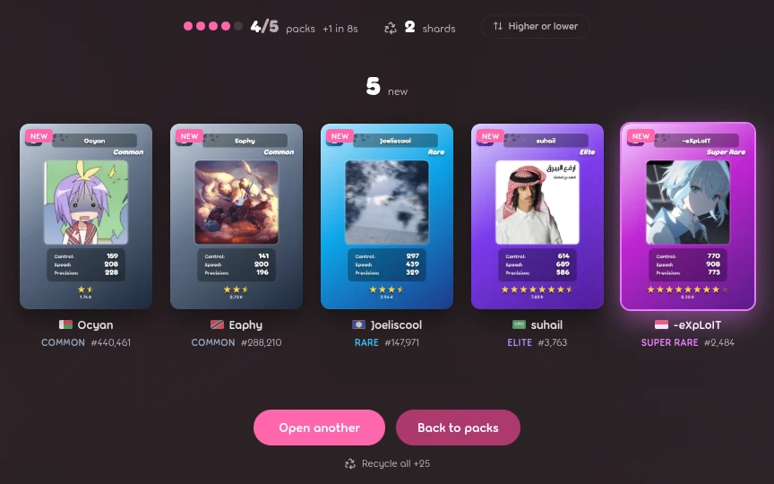
      <h3>Card packs</h3>
      Open packs of tracked players, collect their maniacards and recycle duplicates into shards.
    </td>
    <td width="50%" valign="top">
      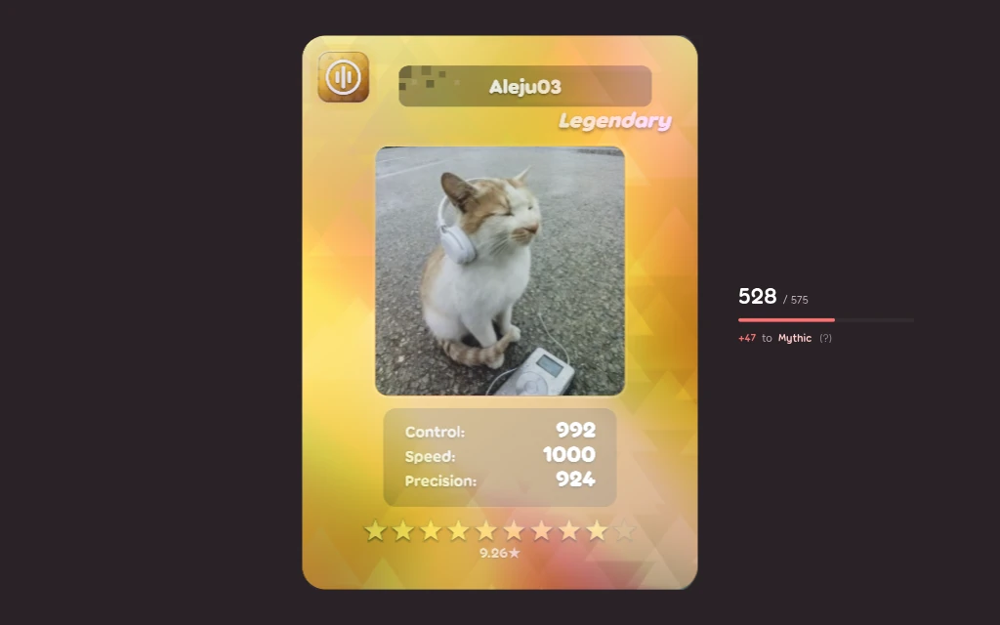
      <h3>Maniacards</h3>
      Every player has a card with Control, Speed and Precision stats and a rarity tier based on their plays, also shown in 3D.
    </td>
  </tr>
</table>

Also on the site: top plays with pp gained, snipes on country leaderboards, a farm helper that picks pp-gain maps from a player's top 200, goals that complete on the qualifying play, a personal stats page, and teams.

## Replay viewer

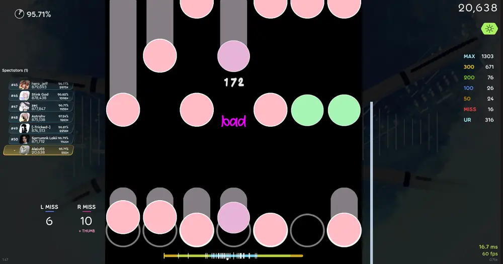

Plays `.osr` replays from stable and lazer in the browser with a custom skin, the map's scoreboard, live judgement counts and a hit error bar. Replays can be compared side by side, uploaded as unlisted links, and exported to video on the device.

## How it works

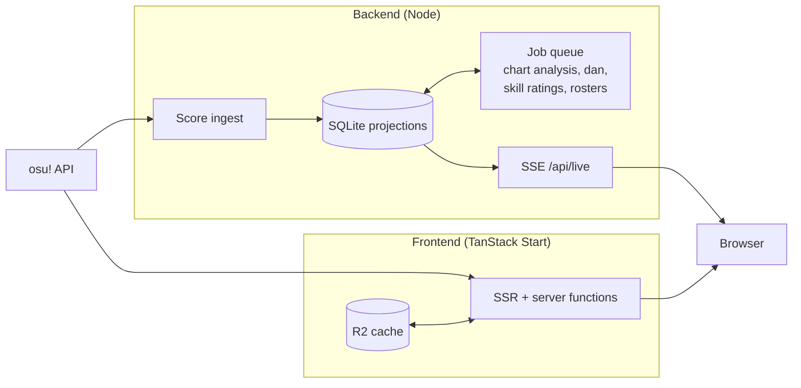

- **Frontend** (`src/`): TanStack Start + React 19, SSR via Nitro, self-hosted behind Cloudflare. File-based routes, one Zustand store, Tailwind v4, Three.js for the 3D cards.
- **Backend** (`backend/`, maintained separately): an always-on Node service that ingests osu!mania scores, keeps SQLite projections, runs a job queue (enrichment, rosters, chart analysis, dan estimates, skill ratings) and pushes deltas over SSE.

Browsers load a snapshot on entry, then subscribe to `/api/live`, and a reconnect replays missed events through `Last-Event-ID`. Authenticated osu! API calls stay server-side behind a rate limiter, and heavy artifacts such as parsed replays are cached in R2.

Endpoints, job types and per-feature models are documented in [`docs/`](docs/). [`AGENTS.md`](AGENTS.md) is the condensed guide for coding agents.

## Rating algorithms

The code that rates charts and players is public in [`algorithms/`](algorithms/): dan estimates, pattern tags, vibro detection, the LN model, the replay judge, and Prism, the MSD calculator for 6K, 7K and 8K, written in Rust. Its [README](algorithms/README.md) explains how the parts fit together.

## License

MIT, see [LICENSE](LICENSE). Vendored third-party code keeps its own license: LeoBlack ([osumania_map_analyser](https://github.com/LeoBlackMT/osumania_map_analyser), MIT) and MinaCalc ([Etterna](https://github.com/etternagame/etterna)).
